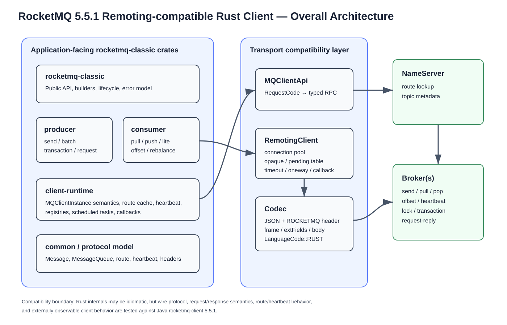
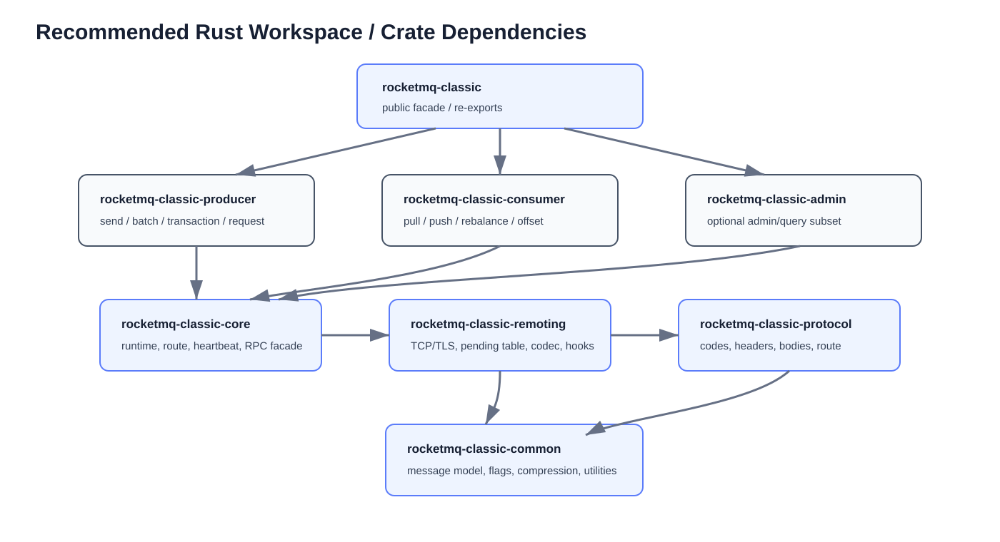
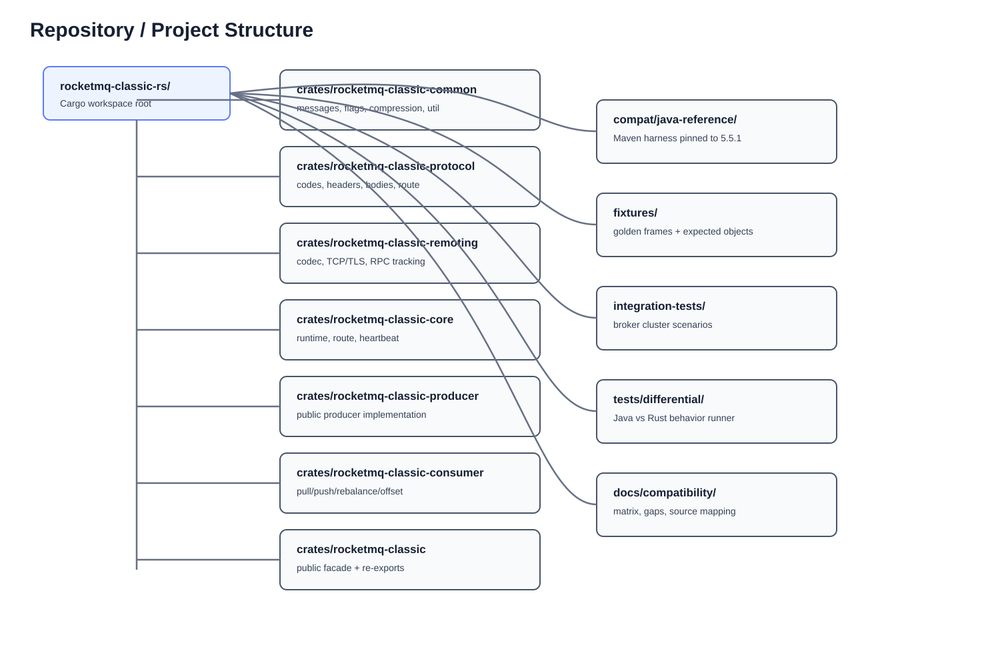
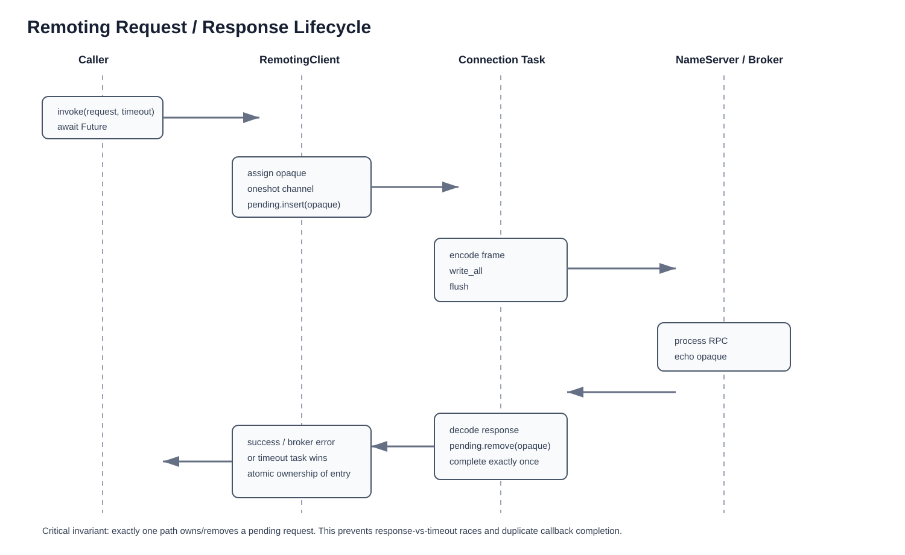
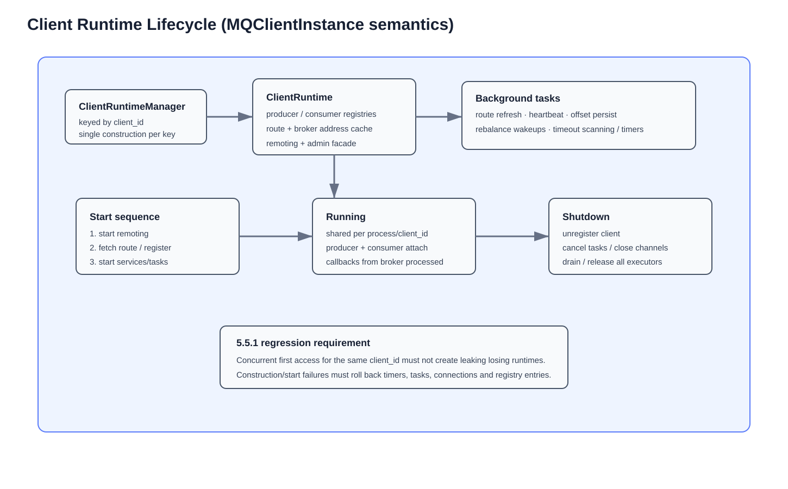
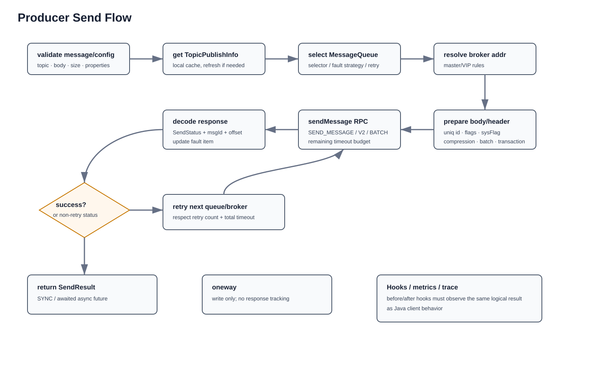
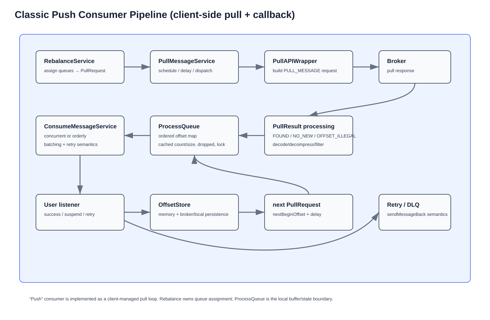
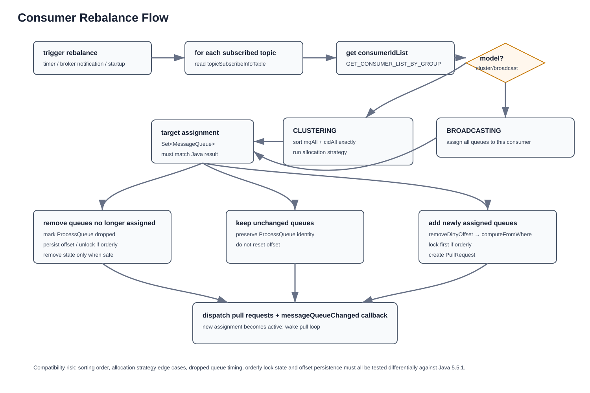
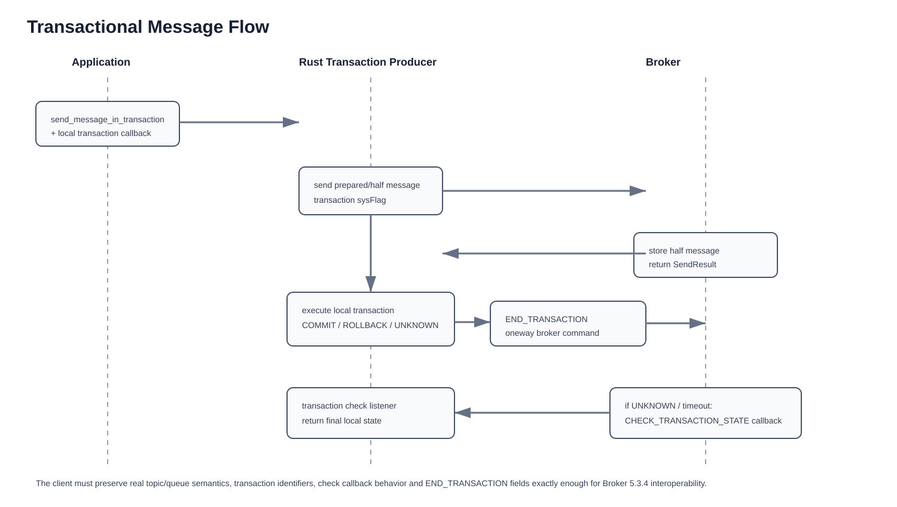
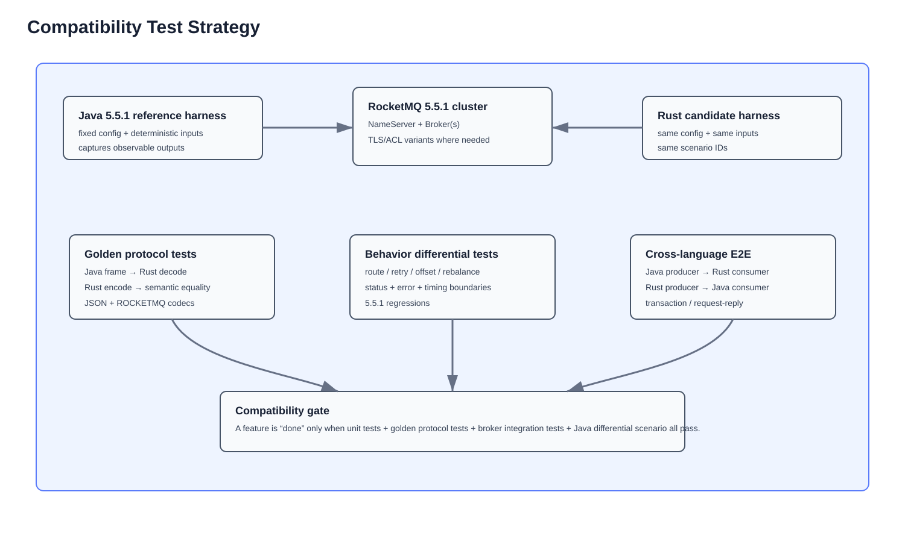

# RocketMQ Java Client 5.5.1 → Rust Remoting Client Implementation Plan

> **Target:** build a Rust client that is wire-compatible and behavior-compatible with Apache RocketMQ Java `rocketmq-client` **5.5.1** (Remoting protocol), while using idiomatic Rust internally.
>
> **Proposed project/repository:** `rocketmq-classic-rs`; primary public crate: `rocketmq-classic`.
>
> **Audience:** junior to senior developers implementing the project phase by phase.
>
> **Reference release:** Apache RocketMQ `rocketmq-all-5.5.1`, released 2026-08-20, tag commit `efa1be59d6fc747ad220f036c86030f05f0419f9`.
>
> **Primary rule:** do not mechanically translate Java classes. Match protocol, externally observable behavior, lifecycle, error semantics, routing, retry, offset, rebalance and transaction behavior. Rust internals should use Rust/Tokio primitives rather than copying Netty/JVM abstractions.

---

## 1. How to use this document

Each phase contains:

- **Goal** — what must work when the phase finishes.
- **Java 5.5.1 reference** — classes/packages to inspect before coding.
- **Rust target** — recommended modules/files.
- **Implementation tasks** — ordered checklist. A junior developer should execute these in order.
- **Tests** — mandatory automated validation.
- **Definition of Done (DoD)** — the gate before starting the next phase.
- **Common mistakes** — implementation traps that frequently produce a client that “works” but is not compatible.

The expected workflow for every task is:

1. Read the listed Java 5.5.1 source at the pinned tag.
2. Add or update the compatibility matrix entry.
3. Write the test/fixture first when the expected behavior can be captured from Java.
4. Implement the smallest Rust change.
5. Run unit tests.
6. Run golden protocol tests if the change touches protocol or serialization.
7. Run broker integration tests if the change touches an RPC.
8. Run Java-vs-Rust differential tests if the change affects behavior.
9. Update the implementation log and compatibility matrix.

**Do not mark a feature complete based only on “it can connect to a Broker”.**

---

## 2. Public source baseline

This plan is based only on public Apache RocketMQ sources.

| Item           | Pinned reference                              |
| -------------- | --------------------------------------------- |
| Release        | `rocketmq-all-5.5.1`                          |
| Release date   | 2026-08-20                                    |
| Release commit | `efa1be59d6fc747ad220f036c86030f05f0419f9`    |
| Java artifact  | `org.apache.rocketmq:rocketmq-client:5.5.1`   |
| Transport      | RocketMQ Remoting protocol over TCP/TLS       |
| Serialization  | JSON and ROCKETMQ private header codec        |
| Language code  | `RUST = 12` exists in RocketMQ `LanguageCode` |

Important 5.5.1 Client/Remoting fixes that must be represented in regression tests include:

- async request-reply callback must not fire multiple times;
- concurrent creation of the same `MQClientInstance` must not leak losing instances/resources;
- blank local serve address is treated as unset;
- optimized Remoting header encoding behavior remains protocol-compatible;
- message-batch input validation remains compatible.

### Primary public source links

- Release notes: <https://rocketmq.apache.org/release-notes/2026/08/20/5.5.1/>
- 5.5.1 tag mirror: <https://apache.googlesource.com/rocketmq/+/refs/tags/rocketmq-all-5.5.1>
- GitHub release/tag: <https://github.com/apache/rocketmq/releases/tag/rocketmq-all-5.5.1>
- `RemotingCommand`: <https://github.com/apache/rocketmq/blob/rocketmq-all-5.5.1/remoting/src/main/java/org/apache/rocketmq/remoting/protocol/RemotingCommand.java>
- `RequestCode`: <https://github.com/apache/rocketmq/blob/rocketmq-all-5.5.1/remoting/src/main/java/org/apache/rocketmq/remoting/protocol/RequestCode.java>
- `MQClientAPIImpl`: <https://github.com/apache/rocketmq/blob/rocketmq-all-5.5.1/client/src/main/java/org/apache/rocketmq/client/impl/MQClientAPIImpl.java>
- `MQClientInstance`: <https://github.com/apache/rocketmq/blob/rocketmq-all-5.5.1/client/src/main/java/org/apache/rocketmq/client/impl/factory/MQClientInstance.java>
- `DefaultMQProducerImpl`: <https://github.com/apache/rocketmq/blob/rocketmq-all-5.5.1/client/src/main/java/org/apache/rocketmq/client/impl/producer/DefaultMQProducerImpl.java>
- `DefaultMQPushConsumerImpl`: <https://github.com/apache/rocketmq/blob/rocketmq-all-5.5.1/client/src/main/java/org/apache/rocketmq/client/impl/consumer/DefaultMQPushConsumerImpl.java>
- `RebalanceImpl`: <https://github.com/apache/rocketmq/blob/rocketmq-all-5.5.1/client/src/main/java/org/apache/rocketmq/client/impl/consumer/RebalanceImpl.java>
- Java client overview: <https://rocketmq.apache.org/zh/docs/sdk/02java/>

### Licensing note

Apache RocketMQ is Apache-2.0 licensed. If implementation is derived from source rather than independently reimplemented from protocol behavior, preserve the Apache license/NOTICE obligations and clearly record modified files and provenance. This document is an engineering plan, not legal advice.

### 2.1 Crate naming and crates.io collision policy

The repository/project name in this plan is **`rocketmq-classic-rs`**. The primary public facade crate is **`rocketmq-classic`**. The word `classic` is intentional: this project targets RocketMQ's classic Remoting/NameServer/Broker client model rather than the RocketMQ 5 Proxy/gRPC client model.

As of **2026-09-19**, exact-name searches across public crates.io/docs.rs indexes found existing RocketMQ Rust packages using names such as `rocketmq`, `rocketmq-rust`, `rocketmq-client`, `rocketmq-client-rust`, `rocketmq-common`, and `rocketmq-remoting`. Therefore this project must not use those package names. The following proposed package names had no exact indexed matches at the time of this check:

| Role                     | crates.io package name      | Rust import name            |
| ------------------------ | --------------------------- | --------------------------- |
| Public facade            | `rocketmq-classic`          | `rocketmq_classic`          |
| Common model/utilities   | `rocketmq-classic-common`   | `rocketmq_classic_common`   |
| Protocol types           | `rocketmq-classic-protocol` | `rocketmq_classic_protocol` |
| Remoting transport       | `rocketmq-classic-remoting` | `rocketmq_classic_remoting` |
| Shared client runtime    | `rocketmq-classic-core`     | `rocketmq_classic_core`     |
| Producer implementation  | `rocketmq-classic-producer` | `rocketmq_classic_producer` |
| Consumer implementation  | `rocketmq-classic-consumer` | `rocketmq_classic_consumer` |
| Optional admin/query API | `rocketmq-classic-admin`    | `rocketmq_classic_admin`    |

Crates.io names are first-come, first-served, and collision checks are case-insensitive and treat `-` and `_` variants as conflicting names. **Immediately before the first publish**, repeat exact-name checks on crates.io for every package above. If any name has become occupied, change the whole prefix consistently rather than publishing a mixture of naming schemes.

Recommended publishing rule:

1. Develop all workspace crates locally from day one using the final `rocketmq-classic-*` package names.
2. Until the public API is stable enough to publish, set `publish = false` on internal crates.
3. Before publishing the facade, publish every facade dependency that cannot remain path-only; crates.io packages cannot depend on unpublished path-only workspace crates.
4. Keep one version number across all published workspace crates for the initial releases to simplify compatibility and dependency management.
5. Do not reserve names by publishing empty placeholder crates. Verify availability immediately before a real release.

---

## 3. Definition of “1:1 compatible”

“1:1” in this project means the following, in priority order.

| Compatibility level       | Requirement                                                                                                                  |
| ------------------------- | ---------------------------------------------------------------------------------------------------------------------------- |
| Wire protocol             | **Mandatory.** Broker/NameServer must accept the Rust frames and Rust must parse valid Java/Broker frames.                   |
| Request/Response code     | **Mandatory.** Codes, headers, body format and response interpretation must match.                                           |
| Message model             | **Mandatory.** Topic, queue, properties, sysFlags, body compression, message IDs and offsets must have compatible semantics. |
| Routing                   | **Mandatory.** Topic route conversion and broker address selection must produce Java-compatible behavior.                    |
| Producer behavior         | **Mandatory.** queue selection, timeout budget, retries and send status handling must match.                                 |
| Consumer behavior         | **Mandatory for v1.0.** offsets, pull status, ProcessQueue semantics, retry, rebalance and orderly locking must match.       |
| Lifecycle                 | **Mandatory.** start/shutdown/register/unregister/background task behavior must not leak resources.                          |
| Public API                | Similar semantics, but Rust naming and `async` design are allowed.                                                           |
| Internal class layout     | **Not required.** Do not recreate Java inheritance, executors or Netty classes literally.                                    |
| Bug-for-bug compatibility | Not a goal unless a bug changes wire-visible semantics required by an existing deployment.                                   |

A Rust API may therefore look idiomatic:

```rust
let producer = Producer::builder()
    .producer_group("payments")
    .nameserver("127.0.0.1:9876")
    .build()
    .await?;

let result = producer.send(
    Message::builder()
        .topic("PaymentCreated")
        .body(bytes::Bytes::from_static(b"hello"))
        .build()?
).await?;
```

It does **not** need to copy Java setters, callbacks and class names as long as observable semantics are equivalent.

---

## 4. Architecture

### 4.1 Overall architecture



The compatibility boundary is below the public Rust API. Everything from typed RPC down to the wire must be validated against Java 5.5.1/Broker 5.5.1.

### 4.2 Workspace dependency structure



Recommended dependency direction:

- `rocketmq-classic-common` has no dependency on client/remoting.
- `rocketmq-classic-protocol` depends on `rocketmq-classic-common`.
- `rocketmq-classic-remoting` depends on `rocketmq-classic-protocol` and `rocketmq-classic-common`.
- `rocketmq-classic-core` depends on remoting/protocol/common.
- `rocketmq-classic-producer` and `rocketmq-classic-consumer` depend on `rocketmq-classic-core`.
- the public `rocketmq-classic` crate is a thin facade/re-export crate.

**Do not allow circular dependencies.**

### 4.3 Repository structure



Recommended paths:

| Path                                | Purpose                                                     |
| ----------------------------------- | ----------------------------------------------------------- |
| `crates/rocketmq-classic-common/`   | messages, flags, compression, common value types            |
| `crates/rocketmq-classic-protocol/` | Remoting codes, headers, bodies, route and heartbeat models |
| `crates/rocketmq-classic-remoting/` | codecs, TCP/TLS, connection management, pending requests    |
| `crates/rocketmq-classic-core/`     | runtime, route cache, heartbeat, MQClientApi facade         |
| `crates/rocketmq-classic-producer/` | Producer implementation                                     |
| `crates/rocketmq-classic-consumer/` | Pull/Push/Lite consumer, offsets, ProcessQueue, rebalance   |
| `crates/rocketmq-classic/`          | public facade and re-exports                                |
| `compat/java-reference/`            | Maven project pinned to Java client 5.5.1                   |
| `fixtures/remoting/`                | binary/JSON golden fixtures                                 |
| `fixtures/messages/`                | encoded message fixtures                                    |
| `integration-tests/`                | real NameServer/Broker scenarios                            |
| `tests/differential/`               | Java vs Rust scenario comparison                            |
| `docs/compatibility/`               | feature/class/request-code matrices                         |
| `examples/`                         | producer/consumer examples                                  |

---

## 5. Rust technical baseline

Recommended initial baseline:

| Area              | Recommendation                                                                                    |
| ----------------- | ------------------------------------------------------------------------------------------------- |
| Rust edition      | 2024                                                                                              |
| Async runtime     | Tokio                                                                                             |
| Byte buffers      | `bytes`                                                                                           |
| Codec integration | `tokio-util` where useful, custom frame codec for exact RocketMQ framing                          |
| JSON              | `serde` + `serde_json`                                                                            |
| Concurrent map    | `dashmap` only where it reduces lock complexity; otherwise use explicit `RwLock<HashMap<...>>`    |
| Locks             | Tokio locks for async critical sections; `parking_lot` only for non-async short critical sections |
| Errors            | `thiserror`; optional `anyhow` only in binaries/tests                                             |
| Logging           | `tracing`                                                                                         |
| TLS               | `tokio-rustls`/`rustls`, with compatibility tests against Broker TLS                              |
| Compression       | implementations selected according to `MessageSysFlag`; do not assume one compression type        |
| Cancellation      | `tokio-util::sync::CancellationToken` or equivalent                                               |
| Testing           | `cargo test`, property tests where useful, Docker/Testcontainers for Broker integration           |

### 5.1 Mandatory engineering rules

1. Public async methods must never hold a synchronous mutex guard across `.await`.
2. Every background task must have an explicit owner and shutdown path.
3. Every request inserted into a pending-response table must have exactly one terminal owner: response, timeout, connection failure or shutdown.
4. Do not use `unwrap()`/`expect()` in protocol input paths.
5. Numeric protocol constants must come from a single source module, not be duplicated across crates.
6. Unknown response/request codes must remain representable as raw integers.
7. Unknown `extFields` must not be discarded when round-tripping a `RemotingCommand`.
8. All timeout values use a single monotonic deadline internally; retries consume the remaining budget.
9. A feature touching serialization is not complete without a golden fixture.
10. A feature touching Broker behavior is not complete without an integration test.

---

# Phase 0 — Freeze the Java 5.5.1 Reference and Test Oracle

## Goal

Create a deterministic Java reference harness so expected behavior can be measured rather than guessed.

This phase must finish **before** implementing the Rust Remoting protocol.

## Java reference

Pin exactly:

```xml
<dependency>
  <groupId>org.apache.rocketmq</groupId>
  <artifactId>rocketmq-client</artifactId>
  <version>5.5.1</version>
</dependency>
```

Also record the repository tag and commit in `compat/java-reference/README.md`.

## Rust/project targets

- `compat/java-reference/`
- `fixtures/remoting/`
- `fixtures/messages/`
- `docs/compatibility/JAVA_5_5_1_COMPATIBILITY.md`
- `tests/differential/scenarios.yaml`

## Implementation tasks

### P0-01 — Create the compatibility matrix

Create columns:

- Java class/method;
- Java source path;
- Rust type/function;
- request code, if any;
- golden fixture ID;
- unit-test ID;
- integration-test ID;
- differential-test ID;
- status: `TODO / IN_PROGRESS / PARTIAL / COMPATIBLE / INTENTIONAL_DIFFERENCE`;
- notes.

Start with at least:

- `RemotingCommand`;
- `RocketMQSerializable`;
- `NettyRemotingClient` behavior;
- `MQClientAPIImpl`;
- `MQClientInstance`;
- `DefaultMQProducerImpl`;
- `PullAPIWrapper`;
- `ProcessQueue`;
- `DefaultMQPushConsumerImpl`;
- `RebalanceImpl`;
- `RemoteBrokerOffsetStore`;
- `LocalFileOffsetStore`;
- `ConsumeMessageConcurrentlyService`;
- `ConsumeMessageOrderlyService`;
- transaction/request-reply classes.

### P0-02 — Java protocol dumper

Implement a small Java utility that can:

- construct a `RemotingCommand` for a chosen request;
- print semantic fields as canonical JSON;
- write encoded bytes to a `.bin` file;
- read a `.bin` response and print decoded semantic fields;
- record `code`, `language`, `version`, `opaque`, `flag`, `remark`, `extFields`, body length and body hash.

Do not compare random `opaque` values literally. Normalize fields that are intentionally nondeterministic.

### P0-03 — Java scenario runner

Create scenario IDs such as:

- `ROUTE-001-get-existing-topic`;
- `ROUTE-002-topic-not-exist`;
- `PROD-001-sync-send`;
- `PROD-002-async-send`;
- `PROD-003-oneway-send`;
- `PROD-004-batch-send`;
- `PROD-005-send-timeout`;
- `CONS-001-query-offset`;
- `CONS-002-pull-found`;
- `CONS-003-pull-no-new-msg`;
- `REBAL-001-average-10q-3c`;
- `ORDER-001-lock-unlock`;
- `TX-001-commit`;
- `TX-002-rollback`;
- `REQ-001-request-reply-success`.

Each scenario writes a machine-readable result JSON.

### P0-04 — Broker test environment

Provide a reproducible local RocketMQ 5.5.1 test cluster with:

- one NameServer;
- one Broker for basic tests;
- optional two-Broker profile for retry/route tests;
- TLS profile;
- auth/ACL profile if supported by target scope;
- deterministic topic/group setup script.

Keep test configuration in source control.

### P0-05 — Golden fixture metadata

Every fixture should have a sidecar metadata file containing:

- source client version;
- scenario ID;
- serialization type;
- request code;
- normalized fields;
- SHA-256 of payload;
- creation command.

## Tests

- Java harness can encode and decode its own fixtures.
- Two runs of deterministic scenarios produce semantically identical normalized output.
- CI verifies the Maven dependency is exactly 5.5.1.

## Definition of Done

- Reference harness starts a Java producer and consumer against Broker 5.5.1.
- At least route lookup, heartbeat, send, pull, offset query/update and lock/unlock fixtures exist.
- Compatibility matrix exists and is version-pinned.

## Common mistakes

- Using `develop` instead of the `rocketmq-all-5.5.1` tag as the behavioral oracle.
- Treating packet captures as the only source of truth; semantic normalized fixtures are also needed.
- Comparing timestamps, opaque IDs or generated message IDs without normalization.

---

# Phase 1 — Common Types, Constants and Protocol Model

## Goal

Implement data structures that can represent all fields needed by later Remoting, Producer and Consumer phases without network I/O.

## Java reference

Focus on:

- `common/.../message/Message.java`
- `MessageExt.java`
- `MessageQueue.java`
- `MessageConst.java`
- `MessageDecoder.java`
- `MessageSysFlag.java`
- `PullSysFlag.java`
- `remoting/.../protocol/LanguageCode.java`
- `SerializeType.java`
- `RequestCode.java`
- `ResponseCode.java`
- route classes: `TopicRouteData`, `BrokerData`, `QueueData`
- heartbeat classes: `HeartbeatData`, `ProducerData`, `ConsumerData`, `SubscriptionData`

## Rust target

Suggested modules:

```text
rocketmq-classic-common/src/message/
rocketmq-classic-common/src/sysflag/
rocketmq-classic-common/src/compression/
rocketmq-classic-protocol/src/codes/
rocketmq-classic-protocol/src/route/
rocketmq-classic-protocol/src/heartbeat/
rocketmq-classic-protocol/src/header/
rocketmq-classic-protocol/src/body/
```

## Implementation tasks

### P1-01 — Protocol primitive policy

Define protocol-safe primitive wrappers:

- request/response code is stored as `i32` or a raw-code newtype, not a closed enum only;
- queue ID is signed integer-compatible with Java;
- broker ID supports Java's integer width;
- offsets use signed 64-bit values;
- timestamps use signed 64-bit millisecond values;
- `opaque` uses signed 32-bit wire representation.

Enums should support `Unknown(raw)` where forward compatibility matters.

### P1-02 — `LanguageCode`

Implement the complete mapping from Java 5.5.1 and include:

- `JAVA = 0`;
- `RUST = 12`;
- unknown-code handling.

Default Rust commands to `RUST`, unless a test deliberately emulates another language.

### P1-03 — `SerializeType`

Implement:

- JSON = 0;
- ROCKETMQ = 1;
- conversion from the high 8 bits of the marked header-length integer.

### P1-04 — Message types

Implement immutable/user-facing `Message` and decoded `MessageExt` separately.

Minimum `Message` state:

- topic;
- body;
- flag;
- properties;
- transaction ID where applicable.

Minimum `MessageExt` adds Broker-populated metadata such as queue ID/offset, commit-log offset, timestamps, hosts, reconsume count, sysFlag and message ID.

Do not make every Java field public/mutable just to resemble Java.

### P1-05 — Message properties

Implement exact Java-compatible conversion between property map and RocketMQ property string.

Requirements:

- preserve key/value semantics;
- reject or correctly handle separators according to Java rules;
- include keys/tags/wait-store/uniq-id/delay/transaction/retry properties;
- round-trip Java fixtures byte-for-byte where deterministic.

### P1-06 — Flags

Port all client-relevant bit constants from:

- `MessageSysFlag`;
- `PullSysFlag`.

Provide helpers such as:

```rust
fn has_compressed_flag(sys_flag: i32) -> bool;
fn compression_type(sys_flag: i32) -> CompressionType;
fn build_pull_sys_flag(commit_offset: bool, suspend: bool, subscription: bool, class_filter: bool) -> i32;
```

Do not spread raw bit arithmetic across producer/consumer code.

### P1-07 — Route models

Implement:

- `TopicRouteData`;
- `BrokerData`;
- `QueueData`;
- ordered-topic metadata/static-topic fields required by 5.5.1;
- helper conversion to publish/subscribe queues.

The conversion logic must be tested separately from network RPC.

### P1-08 — Heartbeat models

Implement Producer/Consumer/Subscription heartbeat structures with Java-compatible JSON field names and collection behavior.

Be careful with deterministic ordering in tests: Java hash-based collections may serialize in unstable order. Compare semantic JSON unless ordering is part of the protocol.

### P1-09 — Request/Response code registry

Port all constants from Java 5.5.1 into a single generated or manually audited module.

At minimum, early phases need:

| Code                           |  Value | Use                 |
| ------------------------------ | -----: | ------------------- |
| `SEND_MESSAGE`                 |     10 | producer            |
| `PULL_MESSAGE`                 |     11 | consumer            |
| `QUERY_CONSUMER_OFFSET`        |     14 | offset              |
| `UPDATE_CONSUMER_OFFSET`       |     15 | offset              |
| `HEART_BEAT`                   |     34 | runtime             |
| `UNREGISTER_CLIENT`            |     35 | lifecycle           |
| `CONSUMER_SEND_MSG_BACK`       |     36 | retry               |
| `END_TRANSACTION`              |     37 | transaction         |
| `GET_CONSUMER_LIST_BY_GROUP`   |     38 | rebalance           |
| `CHECK_TRANSACTION_STATE`      |     39 | broker→client       |
| `NOTIFY_CONSUMER_IDS_CHANGED`  |     40 | broker→client       |
| `LOCK_BATCH_MQ`                |     41 | orderly             |
| `UNLOCK_BATCH_MQ`              |     42 | orderly             |
| `GET_ROUTEINFO_BY_TOPIC`       |    105 | NameServer route    |
| `SEND_MESSAGE_V2`              |    310 | smart send header   |
| `SEND_BATCH_MESSAGE`           |    320 | batch               |
| `SEND_REPLY_MESSAGE`           |    324 | request/reply       |
| `SEND_REPLY_MESSAGE_V2`        |    325 | request/reply       |
| `PUSH_REPLY_MESSAGE_TO_CLIENT` |    326 | broker→client reply |
| `LITE_PULL_MESSAGE`            |    361 | lite pull           |
| `QUERY_ASSIGNMENT`             |    400 | assignment          |
| `SET_MESSAGE_REQUEST_MODE`     |    401 | request mode        |
| `POP_MESSAGE`                  | 200050 | POP                 |
| `ACK_MESSAGE`                  | 200051 | POP ack             |
| `CHANGE_MESSAGE_INVISIBLETIME` | 200053 | POP invisibility    |

The full registry must still be copied/audited from the pinned Java file; this table is not the complete list.

## Tests

- enum/raw-code round trips;
- `MessageQueue` ordering/equality/hash compatibility scenarios;
- property encode/decode golden tests;
- sysFlag bit tests;
- route model JSON fixture tests;
- heartbeat semantic JSON tests.

## Definition of Done

No networking exists yet, but all Phase 0 fixture metadata can be represented by Rust types without dropping fields.

---

# Phase 2 — Remoting Frame Codec

## Goal

Encode/decode RocketMQ Remoting frames byte-for-byte compatible with Java 5.5.1.

## Architecture



## Frame format

Use a table rather than assumptions:

| Wire segment         |      Size | Notes                                                         |
| -------------------- | --------: | ------------------------------------------------------------- |
| total length         |   4 bytes | big-endian; length after this field                           |
| marked header length |   4 bytes | high 8 bits = serialization type; low 24 bits = header length |
| header               |  variable | JSON or ROCKETMQ private header                               |
| body                 | remaining | opaque bytes interpreted by request type                      |

For Java `RemotingCommand.encode()`, the total-length field represents `4 + header_length + body_length` and excludes its own first four bytes.

## Java reference

- `RemotingCommand`
- `RocketMQSerializable`
- `RemotingSerializable`
- `NettyEncoder`
- `NettyDecoder`
- `FastCodesHeader`

## Rust target

Suggested modules:

```text
rocketmq-classic-remoting/src/codec/frame.rs
rocketmq-classic-remoting/src/codec/json_header.rs
rocketmq-classic-remoting/src/codec/rocketmq_header.rs
rocketmq-classic-remoting/src/command.rs
rocketmq-classic-remoting/src/error.rs
```

## Implementation tasks

### P2-01 — `RemotingCommand`

Required fields:

- `code`;
- `language`;
- `version`;
- `opaque`;
- `flag`;
- `remark`;
- `ext_fields`;
- `body`;
- current serialization type.

Provide explicit methods:

- `mark_response_type()`;
- `is_response_type()`;
- `mark_oneway()`;
- `is_oneway()`;
- `add_ext_field()`.

Do not expose internal timeout/pending state from this struct.

### P2-02 — marked header length

Implement and test exactly:

- high 8 bits carry `SerializeType`;
- low 24 bits carry header length;
- reject header lengths exceeding 24-bit representable range;
- reject total frame sizes beyond configured limit before allocation.

### P2-03 — JSON header codec

Match Java field names and number/string behavior.

Golden test both directions:

- Java encode → Rust decode;
- Rust encode → Java decode.

Do not require textual JSON byte equality if Java/serde field order differs; require semantic header equality and successful cross-decoding.

### P2-04 — ROCKETMQ private header codec

Implement the compact header layout used by `RocketMQSerializable`.

Cover at least:

- request code;
- language byte;
- version;
- opaque;
- flags;
- remark length/body;
- ext-fields length/body.

All integer byte order must match Java.

### P2-05 — Custom header flattening

Java custom headers become `extFields` string values. Rust should avoid reflection.

Define a trait such as:

```rust
pub trait CommandHeader {
    fn encode_fields(&self, out: &mut HeaderMap) -> Result<(), ProtocolError>;
}
```

and an inverse typed decode trait.

Rules:

- exact Java field names;
- Java-compatible `toString()` representation for primitive values;
- optional fields omitted when Java omits them;
- required fields validated when decoding.

### P2-06 — Fast path

Do not begin with micro-optimizations. First get golden compatibility passing.

After correctness:

- encode directly into `BytesMut`;
- pre-compute required capacity;
- avoid an intermediate `HashMap` for headers that have a stable set of fields;
- add a `FastCommandHeader`-like path only when benchmarks justify it.

This preserves the intent of 5.5.1's `FastCodesHeader/RocketMQSerializable` allocation optimization without recreating Java reflection internals.

### P2-07 — Incremental TCP decoder

Implement partial-frame handling:

- less than 4 bytes: need more data;
- declared frame larger than configured maximum: protocol error/close;
- incomplete declared frame: need more data;
- exactly one frame: decode;
- multiple frames in buffer: emit each sequentially.

Never allocate from a malicious declared length before checking the configured maximum.

## Tests

Mandatory fixture families:

- route request/response;
- heartbeat;
- send request/response;
- pull request/response;
- offset query/update;
- lock/unlock;
- transaction;
- request-reply;
- JSON serialization;
- ROCKETMQ serialization;
- zero-length remark/body;
- unknown ext field;
- malformed header length;
- oversized frame;
- fragmented frame;
- two frames in one buffer.

## Definition of Done

Every Phase 0 Remoting fixture can be decoded by Rust, and Rust-generated equivalent commands can be decoded by the Java harness.

## Common mistakes

- Treating total length as including the initial 4-byte length field.
- Forgetting that serialize type lives in the high byte of marked header length.
- Converting unknown fields to typed structures and then losing them.
- Allocating body/header before checking frame limits.

---

# Phase 3 — TCP/TLS Remoting Transport

## Goal

Build a reusable async transport that provides the same logical operations as Java's Remoting client:

- request/response;
- async/future response;
- oneway;
- inbound Broker→client request processing;
- connection lifecycle and timeout handling.

## Java reference

- `NettyRemotingClient`
- `NettyRemotingAbstract`
- `ResponseFuture`
- `InvokeCallback`
- channel event listener behavior
- TLS configuration classes

## Rust target

Suggested modules:

```text
rocketmq-classic-remoting/src/client/mod.rs
rocketmq-classic-remoting/src/client/connection.rs
rocketmq-classic-remoting/src/client/connection_manager.rs
rocketmq-classic-remoting/src/client/pending.rs
rocketmq-classic-remoting/src/client/processor.rs
rocketmq-classic-remoting/src/client/tls.rs
```

## Implementation tasks

### P3-01 — Connection object

A connection should own:

- socket/TLS stream;
- write path serialization;
- reader task;
- remote address;
- close/cancel signal;
- health state;
- unique generation/connection identity.

Avoid one task per request.

### P3-02 — Connection manager

Key by normalized remote address.

Required behavior:

- create on demand;
- share healthy connection;
- remove only the same failed connection generation;
- allow reconnect after close;
- avoid a stale close callback removing a newer connection.

### P3-03 — `opaque` generator

Use an atomic wrapping 32-bit counter compatible with Java's signed wire value. Never assume opaque values are positive forever.

### P3-04 — Pending response table

Recommended model:

```rust
struct PendingRequest {
    deadline: Instant,
    tx: oneshot::Sender<Result<RemotingCommand, RemotingError>>,
}
```

The map operation that claims completion must be atomic from the application's point of view:

- response path removes the entry, then completes it;
- timeout path removes the entry, then completes it;
- connection-failure path removes matching requests and completes them;
- shutdown drains the map exactly once.

Do not perform `get()` followed later by `remove()` as two independent ownership operations.

### P3-05 — Request API

Expose an idiomatic API:

```rust
async fn invoke(
    &self,
    addr: &BrokerAddress,
    request: RemotingCommand,
    deadline: Instant,
) -> Result<RemotingCommand, RemotingError>;

async fn invoke_oneway(
    &self,
    addr: &BrokerAddress,
    request: RemotingCommand,
    deadline: Instant,
) -> Result<(), RemotingError>;
```

Java callback-based async invocation maps naturally to Rust futures. Do not recreate callback executors in the public API.

### P3-06 — Timeout budget

Convert user timeout to `deadline = Instant::now() + timeout` once at the outer call.

Every reconnect/retry/write step receives remaining time. Never reset the full timeout for every retry.

### P3-07 — Inbound request processors

The same client connection can receive Broker-originated commands. Add a registry:

```rust
request_code -> Arc<dyn RequestProcessor>
```

Initial processors can return `REQUEST_CODE_NOT_SUPPORTED` until later phases, but the dispatch mechanism must exist.

Eventually it handles transaction checks, consumer notifications, reset-offset requests, direct-consume requests and reply push.

### P3-08 — TLS

Implement behind configuration from the beginning so the connection abstraction does not need to be redesigned later.

Test:

- plain TCP;
- trusted test CA;
- invalid certificate failure;
- hostname/SNI behavior consistent with deployment expectations.

### P3-09 — Shutdown

Shutdown sequence must:

1. reject new invokes;
2. cancel connection creation;
3. close active connections;
4. fail pending responses;
5. join reader/background tasks;
6. release TLS/socket resources.

## 5.5.1-specific regression

Request-reply completion must be **exactly once**. Add a deterministic test where response completion, timeout and cancellation race.

A post-5.5.1 upstream report also describes a response-vs-timeout table race near the timeout boundary. Fixing that race is recommended because it does not intentionally change protocol semantics; document it as a hardening improvement rather than claiming bug-for-bug parity.

## Definition of Done

A raw typed test command can be sent to a 5.5.1 NameServer/Broker and receive a correctly matched response under concurrent load, timeout and connection-close tests.

---

# Phase 4 — Typed Request Headers and Protocol Bodies

## Goal

Replace ad-hoc maps with typed request/response structures while preserving exact Java `extFields` names.

## Java reference

Search under:

- `remoting/.../protocol/header/`
- `remoting/.../protocol/body/`
- `common/.../protocol/header/` where applicable in the pinned source layout.

## Rust target

```text
rocketmq-classic-protocol/src/header/*.rs
rocketmq-classic-protocol/src/body/*.rs
rocketmq-classic-protocol/src/rpc.rs
```

## Implementation tasks

### P4-01 — Header trait

Each header has:

- a Rust struct;
- encode-to-ext-fields;
- decode-from-ext-fields;
- required-field validation;
- unit test against Java fixture.

### P4-02 — First-wave headers

Implement in this order:

1. `GetRouteInfoRequestHeader`;
2. `SendMessageRequestHeader`;
3. `SendMessageRequestHeaderV2`;
4. `PullMessageRequestHeader`;
5. `QueryConsumerOffsetRequestHeader`;
6. `UpdateConsumerOffsetRequestHeader`;
7. heartbeat body;
8. unregister header;
9. consumer-list header;
10. lock/unlock body.

### P4-03 — Consumer/POP headers

Then add:

- send-message-back;
- query assignment;
- set request mode;
- POP;
- ACK;
- change invisibility;
- notification/polling info if used by Java client paths.

### P4-04 — Transaction/request-reply headers

Add:

- end transaction;
- transaction check request parsing;
- reply message headers;
- correlation/reply metadata properties.

### P4-05 — Unknown field preservation

Typed decoding should retain an optional raw map if a command may need to be forwarded/re-encoded. Never make compatibility depend on the Rust source knowing every future field.

## Tests

For every header:

- canonical expected field map;
- omitted optional field;
- missing required field;
- invalid numeric field;
- Java→Rust fixture;
- Rust→Java decode test.

## Definition of Done

No Phase 5 RPC method manually constructs arbitrary string maps for known headers.

---

# Phase 5 — `MQClientApi`: Typed RPC Facade

## Goal

Implement the network RPC facade equivalent in purpose to `MQClientAPIImpl`.

This is the boundary where protocol/transport errors become RocketMQ domain-level results.

## Rust target

```text
rocketmq-classic-core/src/api/mod.rs
rocketmq-classic-core/src/api/route.rs
rocketmq-classic-core/src/api/producer.rs
rocketmq-classic-core/src/api/consumer.rs
rocketmq-classic-core/src/api/transaction.rs
```

## Implementation tasks

### P5-01 — Error taxonomy

Define separate errors:

- protocol malformed;
- connect failure;
- transport closed;
- timeout;
- Broker response error with response code/remark;
- NameServer response error;
- invalid client configuration;
- unsupported feature.

Do not collapse all failures into strings.

### P5-02 — Route API

Implement `get_topic_route_info_from_nameserver()` using `GET_ROUTEINFO_BY_TOPIC`.

Validate:

- existing topic;
- missing topic;
- multiple NameServers;
- malformed response.

### P5-03 — Producer RPCs

Implement:

- send message;
- send message V2;
- batch send;
- end transaction.

Do not implement Producer retry policy here. `MQClientApi` should execute one logical RPC attempt.

### P5-04 — Consumer RPCs

Implement:

- pull message;
- query consumer offset;
- update consumer offset;
- get consumer list by group;
- consumer send message back;
- lock batch MQ;
- unlock batch MQ.

### P5-05 — Heartbeat/lifecycle RPCs

Implement:

- heartbeat;
- unregister client;
- optional heartbeat V2 behavior if the Java client enables it.

### P5-06 — POP/Lite APIs

Implement required lower-level calls before exposing public POP/Lite consumers:

- `POP_MESSAGE`;
- `ACK_MESSAGE`;
- `CHANGE_MESSAGE_INVISIBLETIME`;
- `LITE_PULL_MESSAGE`;
- `QUERY_ASSIGNMENT`;
- `SET_MESSAGE_REQUEST_MODE`.

### P5-07 — Response-code mapping

Create explicit mapping functions. A response code that is successful for one RPC may not be interpreted identically for another.

Example: Pull RPC maps Broker response codes into `PullStatus` and offset fields, rather than treating every non-zero code as a generic error.

## Tests

Every method must have:

- mocked Remoting response test;
- real Broker/NameServer test;
- Java differential result for at least one success and one error case.

## Definition of Done

All primary client RPCs exist independently of Producer/Consumer public logic and have no Java-style global singleton dependency.

---

# Phase 6 — Client Runtime, NameServer Routing and Heartbeat

## Goal

Implement the shared process-level runtime corresponding to the responsibilities of `MQClientInstance` and `MQClientManager`.

## Architecture



## Java reference

- `MQClientManager`
- `MQClientInstance`
- `ClientConfig`
- `TopicPublishInfo`
- route conversion helpers
- `RebalanceService`
- `PullMessageService`

## Rust target

```text
rocketmq-classic-core/src/runtime/manager.rs
rocketmq-classic-core/src/runtime/runtime.rs
rocketmq-classic-core/src/runtime/tasks.rs
rocketmq-classic-core/src/route/cache.rs
rocketmq-classic-core/src/heartbeat.rs
rocketmq-classic-core/src/config.rs
```

## Implementation tasks

### P6-01 — Client ID

Implement Java-compatible client identity semantics from `ClientConfig`:

- client IP/address component;
- instance name;
- optional unit/namespace-related components used by Java.

Create fixtures showing exactly how 5.5.1 builds IDs for the configurations you support.

### P6-02 — Runtime manager

For a given client ID, concurrent first access must return one runtime and must not leak resources from losing constructions.

Use a per-key single-initialization design, for example:

- map entry containing an async once-cell; or
- per-key lock/entry API;
- never construct a resource-heavy runtime before atomically owning the key.

Different client IDs should still initialize concurrently.

### P6-03 — Runtime state machine

Recommended states:

- `Created`;
- `Starting`;
- `Running`;
- `ShuttingDown`;
- `Stopped`;
- `Failed`.

All transitions must be idempotent or return an explicit state error.

### P6-04 — Registries

Maintain:

- producer group → weak/owned producer runtime handle;
- consumer group → consumer runtime handle.

Reject duplicate group registration according to Java semantics.

### P6-05 — Route caches

Maintain at least:

- topic → `TopicRouteData`;
- broker name → broker ID/address map;
- topic → publish info;
- consumer subscribe info.

Route update must be atomic enough that readers never observe a partially converted route.

### P6-06 — Scheduled route refresh

Default `ClientConfig` values to preserve unless overridden:

- NameServer polling: 30,000 ms;
- Broker heartbeat: 30,000 ms;
- consumer offset persistence: 5,000 ms.

Implement these as cancellable tasks owned by `ClientRuntime`, not detached Tokio tasks.

### P6-07 — Heartbeat construction

Build heartbeat data from current registered producer/consumer state.

Tests must cover:

- producer only;
- consumer only;
- both;
- subscription change;
- consumer unregister;
- heartbeat V1/V2 configuration.

### P6-08 — Broker address resolution

Implement:

- publish address lookup;
- subscribe address lookup;
- master/slave selection rules needed by consumer;
- VIP channel address transformation if enabled.

Do not hide address transformation inside socket code; keep it a tested routing function.

### P6-09 — Broker→client request processor registry

Register processors needed by later phases, initially with stubs:

- transaction state check;
- notify consumer IDs changed;
- reset consumer offset;
- get consumer status;
- consume message directly;
- push reply message.

### P6-10 — Shutdown rollback

A start failure must clean up everything already started. Add fault injection after each startup step and assert zero leaked tasks/connections.

## 5.5.1 regression gate

The upstream 5.5.1 fix for duplicate `MQClientInstance` construction is a required test. Run many concurrent `get_or_create` calls for one client ID and assert:

- one runtime identity;
- no orphan task sets;
- no orphan socket pools;
- failed construction removes only its own incomplete mapping.

## Definition of Done

Multiple Producers/Consumers can share a runtime and route/heartbeat background tasks run and shut down cleanly.

---

# Phase 7 — Producer Core

## Goal

Deliver the first useful client milestone: a production-shaped Producer that can send to RocketMQ 5.5.1 without Proxy/gRPC.

## Architecture



## Java reference

- `DefaultMQProducer`
- `DefaultMQProducerImpl`
- `TopicPublishInfo`
- `MQFaultStrategy`
- latency fault-tolerance classes
- `Validators`
- `MessageClientIDSetter`

## Rust target

```text
rocketmq-classic-producer/src/producer.rs
rocketmq-classic-producer/src/config.rs
rocketmq-classic-producer/src/send.rs
rocketmq-classic-producer/src/selector.rs
rocketmq-classic-producer/src/fault.rs
rocketmq-classic-producer/src/batch.rs
```

## Required default semantics

Java-compatible defaults include:

- send timeout: 3000 ms;
- compression threshold: 4 KiB;
- synchronous retry count: 2 additional retry attempts;
- asynchronous retry count: 2;
- `retryAnotherBrokerWhenNotStoreOK`: false;
- max message size: 4 MiB;
- default topic queue count: 4 where applicable.

Keep these defaults centralized and tested.

## Implementation tasks

### P7-01 — Producer lifecycle

Implement:

- builder/config validation;
- group registration with shared runtime;
- initial topic publish info;
- start;
- shutdown/unregister.

`start()` must be safe against duplicate invocation according to the chosen Rust API contract.

### P7-02 — Message validation

Match Java constraints for:

- topic validity;
- non-null body;
- body size;
- batch constraints;
- forbidden/system topics where client validates them;
- property restrictions.

### P7-03 — Topic route acquisition

Send path:

1. read cached `TopicPublishInfo`;
2. if not usable, refresh route from NameServer;
3. convert route to writable queues;
4. fail with compatible error if still unavailable.

### P7-04 — Queue selection

Implement the default queue selection including avoidance of the last failed broker when Java does so.

Then support a Rust queue-selector trait equivalent in semantics to Java `MessageQueueSelector`.

### P7-05 — Send request construction

Build Java-compatible send headers, including:

- producer group;
- topic;
- default topic and queue count where used;
- queue ID;
- sysFlag;
- born timestamp;
- flag;
- properties;
- reconsume/max-reconsume fields when relevant;
- unit/batch fields where relevant.

Support smart/V2 header encoding when Java 5.5.1 uses it.

### P7-06 — Unique message ID

Implement the same externally required semantics for client-side unique IDs. If exact byte-for-byte Java ID format is needed by existing tooling, port and fixture-test it; otherwise document any intentional difference before release.

For a “1:1” target, default to compatibility.

### P7-07 — Compression

Compress only when Java would compress based on threshold/configuration.

Preserve original message body semantics visible to user hooks. Ensure retry does not repeatedly compress an already-compressed buffer.

### P7-08 — Retry loop

For synchronous send:

- total attempts = first attempt + configured retries;
- use remaining timeout budget;
- choose another queue/broker according to Java strategy;
- classify exceptions/response statuses;
- update fault information;
- return compatible final error.

Test the case where Broker stores a message but the response times out; document duplicate-delivery implications.

### P7-09 — Send modes

Support:

- sync;
- async as Rust future;
- oneway.

Public Rust API does not need Java callback overloads, but behavior and timeout/retry semantics must match.

### P7-10 — Batch send

Implement Java 5.5.1 batch validation before encoding:

- messages non-empty;
- compatible topic constraints;
- no unsupported message form in batch;
- total encoded size validation;
- Java-compatible batch body encoding.

Add regression tests for the 5.5.1 batch validation changes.

### P7-11 — Send result mapping

Map response into:

- send status;
- message ID;
- offset message ID;
- queue;
- queue offset;
- transaction ID/region/trace fields if present.

Unknown response codes remain available in error details.

### P7-12 — Latency fault strategy

Do this **after** basic sending passes.

Port observable behavior, not Java synchronization primitives:

- broker fault item;
- latency-based isolation duration;
- fallback queue selection;
- detector behavior/config if enabled in 5.5.1.

## Tests

At minimum:

- one Broker sync send;
- async send;
- oneway;
- explicit queue;
- selector;
- route refresh;
- first Broker failure, retry another Broker;
- timeout budget exhaustion;
- body just below/at/above compression threshold;
- max size boundary;
- batch valid/invalid;
- retryable/non-retryable response code set;
- fault-strategy deterministic unit tests.

## Definition of Done

Rust Producer passes Java differential scenarios for normal send, retries and batch and can run a sustained integration workload without pending-response/task leaks.

---

# Phase 8 — Message Binary Decode and Pull Result Processing

## Goal

Implement the client-side decoding path required by Pull/Push consumers.

## Java reference

- `MessageDecoder`
- `MessageExt`
- compression helpers
- `PullResultExt`
- `PullAPIWrapper.processPullResult`

## Implementation tasks

### P8-01 — Message binary decoder

Decode Broker message bodies into `MessageExt` using exact field sizes/order from Java.

Support:

- single message;
- multiple messages in pull body;
- IPv4/IPv6 host fields as indicated by sysFlag;
- properties;
- body CRC field representation;
- transaction/prepared offsets where applicable.

### P8-02 — Compression decode

Honor compression flags and supported compression types.

Configuration must allow Java-compatible `decodeReadBody` / `decodeDecompressBody` behavior where exposed by 5.5.1.

### P8-03 — Pull status mapping

Implement:

- FOUND;
- NO_NEW_MSG;
- NO_MATCHED_MSG;
- OFFSET_ILLEGAL;
- next/min/max offsets;
- suggested broker ID.

### P8-04 — Client-side filtering path

Implement the same post-pull filtering needed for tag/class-filter logic used by Java's wrapper. SQL92 broker-side behavior should not be incorrectly reproduced as local filtering.

## Tests

Use Broker-produced binary message fixtures and Java-decoded expected JSON. Include compressed and uncompressed messages.

## Definition of Done

The Rust decoder produces semantically equal `MessageExt` lists from Java/Broker pull-response bodies.

---

# Phase 9 — Pull Consumer and Offset Store

## Goal

Implement explicit Pull Consumer primitives and the offset storage abstraction before building Push Consumer scheduling.

## Java reference

- Pull consumer implementations used in 5.5.1;
- `PullAPIWrapper`;
- `OffsetStore`;
- `RemoteBrokerOffsetStore`;
- `LocalFileOffsetStore`.

## Rust target

```text
rocketmq-classic-consumer/src/pull/
rocketmq-classic-consumer/src/offset/mod.rs
rocketmq-classic-consumer/src/offset/remote.rs
rocketmq-classic-consumer/src/offset/local.rs
```

## Implementation tasks

### P9-01 — OffsetStore trait

Required operations:

- load;
- update offset;
- update-and-freeze offset if required by target Java behavior;
- read offset by read mode;
- persist one/all;
- remove offset;
- clone offset table;
- update to Broker.

### P9-02 — Remote Broker offset store

Implement query/update using Phase 5 RPCs.

Preserve semantics for:

- no offset found;
- memory-first vs broker-first read modes;
- increase-only updates;
- oneway offset update where Java uses it.

### P9-03 — Local file offset store

Needed for broadcasting compatibility.

Make filesystem location configurable while preserving a Java-compatible default strategy if practical. Use atomic file replacement to avoid corrupted state.

### P9-04 — Pull API

Public pull operation accepts:

- message queue;
- expression/subscription;
- offset;
- max message count;
- timeout/suspend parameters.

Route to the correct Broker ID using suggested broker logic.

### P9-05 — Offset boundary helpers

Implement search/max/min/earliest offset RPCs if they are part of the public compatibility surface selected for v1.0.

## Tests

- remote offset missing/present;
- update then query;
- increase-only race;
- local file load/persist/recovery;
- pull found/no-new/illegal offset;
- Broker suggested ID behavior.

## Definition of Done

A manual pull loop can consume messages and persist offsets correctly without using Push Consumer services.

---

# Phase 10 — Push Consumer Core Pipeline

## Goal

Implement the classic `DefaultMQPushConsumer` behavior: the client internally pulls and dispatches messages to a listener.

## Architecture



## Java reference

- `DefaultMQPushConsumer`
- `DefaultMQPushConsumerImpl`
- `PullMessageService`
- `PullRequest`
- `ProcessQueue`
- `ConsumeMessageService`
- `ConsumeMessageConcurrentlyService`

## Rust target

```text
rocketmq-classic-consumer/src/push/consumer.rs
rocketmq-classic-consumer/src/push/pull_service.rs
rocketmq-classic-consumer/src/process_queue.rs
rocketmq-classic-consumer/src/consume/concurrent.rs
```

## Implementation tasks

### P10-01 — Consumer configuration validation

Validate group, message model, consume-from policy, subscriptions, thread/concurrency settings, batch size and listener presence.

### P10-02 — Startup order

Replicate semantic order:

1. validate config/subscriptions;
2. obtain shared client runtime;
3. configure rebalance object;
4. construct Pull API wrapper;
5. choose offset store based on message model unless user provided one;
6. load offsets;
7. construct consume service based on listener type;
8. register consumer group;
9. start shared runtime;
10. update route/subscription info;
11. heartbeat;
12. trigger immediate rebalance.

If any step fails, roll back all previous ownership.

### P10-03 — `ProcessQueue`

Model the local queue buffer/state including:

- messages ordered by queue offset;
- cached message count/size;
- queue lock state and lock timestamp;
- dropped flag;
- last pull timestamp;
- consuming state;
- commit/consumed offset bookkeeping required by concurrent/orderly paths.

Choose a Rust data structure that preserves queue-offset ordering; do not use a plain unordered map.

### P10-04 — Pull request scheduler

Each assigned message queue has a logical PullRequest state.

The service must support:

- immediate pull;
- delayed requeue;
- pause/suspend;
- cancellation when ProcessQueue is dropped;
- backpressure when cached messages exceed thresholds.

Do not create an unbounded Tokio task for every pull iteration.

### P10-05 — Pull response processing

For FOUND:

- update next offset;
- insert messages into ProcessQueue;
- submit consume request;
- schedule next pull according to interval/flow control.

For NO_NEW/NO_MATCHED:

- update next offset;
- correct tags offset behavior if applicable;
- schedule next pull.

For OFFSET_ILLEGAL:

- mark queue dropped;
- persist/update corrected offset according to Java behavior;
- remove queue later through rebalance-safe path.

### P10-06 — Concurrent consumption

Implement listener result semantics:

- success removes consumed messages and advances in-memory offset;
- retry sends/requeues according to Java behavior;
- partial batch acknowledgement semantics must match Java's `ackIndex` handling if supported;
- consumption hook context fires in compatible order.

### P10-07 — Send message back / retry topic

Implement Broker `CONSUMER_SEND_MSG_BACK` path and Java's fallback behavior where required.

Test retry count, delay level and DLQ transition behavior with Broker configuration.

### P10-08 — Flow control

Port thresholds relevant to:

- cached count per queue;
- cached MiB per queue;
- maximum offset span;
- consume-thread backlog.

Use metrics/logging so flow-control events are observable.

## Tests

- startup rollback at every step;
- continuous consume success;
- listener failure/retry;
- flow control;
- dropped ProcessQueue does not receive new consume tasks;
- offset advances only after successful semantics;
- shutdown with in-flight listener callbacks.

## Definition of Done

Java Producer → Rust Push Consumer and Rust Producer → Java Push Consumer scenarios both work with correct offsets and retry behavior.

---

# Phase 11 — Rebalance

## Goal

Implement queue assignment with Java-compatible deterministic results and ProcessQueue lifecycle.

## Architecture



## Java reference

- `RebalanceImpl`
- `RebalancePushImpl`
- allocation strategy classes
- `RebalanceService`

The official RocketMQ design documentation describes the client-side rebalance service as periodically invoking rebalance logic and using `GET_CONSUMER_LIST_BY_GROUP` for clustering mode.

## Rust target

```text
rocketmq-classic-consumer/src/rebalance/mod.rs
rocketmq-classic-consumer/src/rebalance/strategy/*.rs
rocketmq-classic-consumer/src/rebalance/service.rs
```

## Implementation tasks

### P11-01 — Allocation strategy trait

```rust
pub trait AllocateMessageQueueStrategy: Send + Sync {
    fn allocate(
        &self,
        consumer_group: &str,
        current_client_id: &str,
        queues: &[MessageQueue],
        consumer_ids: &[String],
    ) -> Result<Vec<MessageQueue>, RebalanceError>;
}
```

Input sorting must be explicit and identical to Java before the strategy runs.

### P11-02 — Average strategy

Port `AllocateMessageQueueAveragely` first.

Golden scenarios:

- 0/1/N queues;
- 1/N consumers;
- fewer queues than consumers;
- 10 queues / 3 consumers;
- current client missing from list.

### P11-03 — Other Java strategies

Implement the 5.5.1 public strategies selected for parity, including circle and consistent-hash variants and machine-room strategy if present in the public API.

Each gets direct Java-vs-Rust allocation differential tests.

### P11-04 — Broadcasting

Broadcast model bypasses group allocation and assigns every subscribed queue locally.

### P11-05 — Clustering consumer list

Use `GET_CONSUMER_LIST_BY_GROUP` and preserve:

- sorting;
- empty/missing response behavior;
- logging/error handling;
- retry on next rebalance cycle.

### P11-06 — Remove old assignments

For queues no longer assigned:

- mark ProcessQueue dropped first;
- persist offset as required;
- unlock Broker queue for orderly consumption;
- remove local state only when safe;
- prevent stale pull requests from resurrecting it.

### P11-07 — Add new assignments

For new queues:

1. remove dirty offset state;
2. if orderly, acquire Broker lock first;
3. calculate start offset from ConsumeFromWhere policy;
4. create ProcessQueue;
5. create PullRequest;
6. dispatch PullRequest.

### P11-08 — Rebalance triggers

Support:

- periodic interval;
- startup immediate rebalance;
- Broker notification `NOTIFY_CONSUMER_IDS_CHANGED` wakeup;
- subscription change.

Coalesce repeated wakeups rather than spawning unlimited work.

### P11-09 — Race tests

Simulate:

- queue removed while pull response arrives;
- queue reassigned while listener is running;
- rapid consumer join/leave;
- rebalance during shutdown;
- two rebalance triggers concurrently.

## Definition of Done

For a fixed queue list and consumer-ID list, Rust allocation exactly matches Java for all supported strategies, and multi-consumer integration tests demonstrate no persistent duplicate ownership after rebalance settles.

---

# Phase 12 — Orderly Consumption and Queue Locks

## Goal

Match Java orderly consumption semantics using Broker queue locks and local serialization.

## Java reference

- `ConsumeMessageOrderlyService`
- orderly branches in `RebalanceImpl`
- lock/unlock headers/bodies
- `ProcessQueue` lock fields

## Implementation tasks

### P12-01 — Broker lock/unlock

Implement:

- batch lock request;
- batch unlock request;
- lock result application to ProcessQueue;
- periodic lock renewal.

### P12-02 — Local consume lock

Only one orderly consume operation for a queue may manipulate its consumption state at once.

Use an async-aware queue-specific lock. Do not hold a global lock across user callbacks.

### P12-03 — Lock expiry

Model Java lock freshness and reacquisition behavior. A stale Broker lock must pause/suspend orderly processing rather than silently proceed.

### P12-04 — Orderly listener result

Map success/suspend/rollback/commit semantics supported by 5.5.1. Preserve retry/suspend delay rules and in-memory offset updates.

### P12-05 — Rebalance interaction

When losing a queue:

- mark dropped;
- finish/abort local work according to safe semantics;
- persist offset;
- unlock Broker queue.

When gaining:

- lock Broker before normal pull/consume activation.

## Tests

- lock success/failure;
- renewal;
- lock lost mid-consume;
- two consumer instances competing for same queue;
- rebalance while callback is slow;
- graceful shutdown unlock.

## Definition of Done

Orderly per-queue processing remains ordered under concurrent queues and consumer membership changes.

---

# Phase 13 — Lite Pull, Assignment and POP APIs

## Goal

Cover additional Remoting consumer features present in the Java 5.5.1 codebase rather than stopping at classic Push Consumer.

This phase can be split into separate milestones if the project's required public surface is smaller.

## Java reference

- `DefaultLitePullConsumer` and implementation;
- assignment APIs;
- POP-related result/callback structures used by `MQClientAPIImpl`;
- `RequestCode.LITE_PULL_MESSAGE`, `QUERY_ASSIGNMENT`, `SET_MESSAGE_REQUEST_MODE`;
- POP/ACK/change-invisibility request handling.

## Implementation tasks

### P13-01 — Compatibility-scope decision

Before coding, update matrix for each Java public API:

- supported in v1.0;
- supported later;
- intentionally not exposed but lower-level RPC available.

Do not silently omit APIs while calling the project “1:1”.

### P13-02 — Lite Pull

Implement assignment/subscription modes, polling semantics, pause/resume and commit behavior according to Java 5.5.1.

### P13-03 — Broker assignment

Implement `QUERY_ASSIGNMENT` and static/request-mode response conversion.

### P13-04 — POP lower-level API

Implement and integration-test:

- pop;
- ack;
- batch ack if used;
- change invisibility;
- extra-info parsing;
- receipt/handle fields.

### P13-05 — POP result rebuild rules

5.5.1 includes POP-related correctness fixes elsewhere in the server/proxy stack. Ensure client parsing preserves values such as pop time/invisibility metadata rather than reconstructing them incorrectly.

## Definition of Done

Every Java 5.5.1 consumer-facing API has an explicit compatibility status and all “supported” entries have integration tests.

---

# Phase 14 — Transaction Producer

## Goal

Support transactional messages using the Remoting protocol.

## Architecture



## Java reference

- `TransactionMQProducer`;
- `DefaultMQProducerImpl.sendMessageInTransaction`;
- `TransactionListener`;
- `LocalTransactionState`;
- `EndTransactionRequestHeader`;
- Broker→client transaction check processor.

## Implementation tasks

### P14-01 — Transaction Producer API

Expose:

- send half/prepared message;
- local transaction callback;
- transaction-check callback;
- configurable callback concurrency/executor semantics in Rust form.

### P14-02 — Half message send

Set transaction-prepared flag/properties exactly as Java requires and use normal Producer routing/send infrastructure.

### P14-03 — Local transaction execution

After successful half-message send:

- call user local transaction function;
- map Rust result to COMMIT/ROLLBACK/UNKNOWN;
- ensure panic/cancellation/error maps to the documented compatible state policy.

### P14-04 — End transaction command

Build correct header fields from `SendResult` and local transaction state. Send using the mode Java uses (typically oneway command semantics for end transaction).

### P14-05 — Transaction check processor

Handle inbound `CHECK_TRANSACTION_STATE`:

- decode message/body/header;
- dispatch to the correct producer group/listener;
- call transaction check callback;
- send final END_TRANSACTION decision;
- do not block connection reader loop on long user code.

### P14-06 — Lifecycle

Transaction callback workers/tasks are owned by producer/runtime and must terminate on shutdown.

## Tests

- commit;
- rollback;
- unknown then Broker check;
- callback error;
- producer shutdown while check is in flight;
- Java producer/Rust consumer and Rust transaction producer/Broker compatibility.

## Definition of Done

Broker 5.5.1 completes commit/rollback/check flows with the Rust producer and the final message visibility matches Java behavior.

---

# Phase 15 — Request / Reply

## Goal

Implement Java Remoting request/reply semantics, including correlation and Broker-pushed replies.

## Java reference

- Producer request methods;
- `RequestFutureHolder` / request future table classes;
- reply message handling;
- `RequestCallback`;
- `PUSH_REPLY_MESSAGE_TO_CLIENT` processor.

## Implementation tasks

### P15-01 — Correlation metadata

Implement RocketMQ message properties for:

- correlation ID;
- reply-to client;
- request TTL/deadline.

Do not invent new metadata names.

### P15-02 — Pending request table

This is separate from Remoting's `opaque` table. Key it by RocketMQ request correlation ID.

Store:

- deadline;
- response sender/future;
- completion state.

### P15-03 — Send request message

Register pending correlation before sending to avoid a fast-reply race. On send failure, atomically remove and fail the request.

### P15-04 — Push reply processor

Handle Broker→client `PUSH_REPLY_MESSAGE_TO_CLIENT`:

- decode reply;
- extract correlation ID;
- atomically claim pending request;
- complete exactly once;
- return the expected Remoting response to Broker.

### P15-05 — Timeout scan

Timeout and reply delivery compete for the same ownership operation. There must never be two callback/future completions.

### P15-06 — 5.5.1 regression test

The 5.5.1 release explicitly fixes async request-reply callbacks firing multiple times. Create a stress test with:

- reply arriving at timeout boundary;
- duplicate reply frame;
- timeout scanner racing with reply processor;
- caller cancellation.

Assert one user-visible completion.

## Definition of Done

Java requester ↔ Rust responder path and Rust requester ↔ Java responder path can be exercised with matching correlation/timeout behavior.

---

# Phase 16 — Namespace, Hooks, ACL/TLS, Trace and Operational Features

## Goal

Cover cross-cutting behavior needed by real deployments.

## 16.1 Namespace

Implement Java-compatible topic/group namespace wrapping and unwrapping.

Test:

- normal topic;
- retry topic;
- DLQ topic;
- already-namespaced input;
- response message topic stripping.

## 16.2 RPC hooks

Provide before/after hook extension points equivalent in purpose to Java `RPCHook`.

Hooks must be able to modify ext fields before encode for auth/signature use cases.

## 16.3 ACL/auth

Do not hardwire auth into Remoting transport. Implement through hooks/interceptors where possible.

If targeting Apache's current ACL implementation, pin behavior to the server/client code available in 5.5.1 and build dedicated signed-request fixtures.

## 16.4 TLS

Complete all configuration/public API documentation and interoperability tests.

## 16.5 Trace hooks

If message trace parity is in scope:

- reproduce trace event semantics;
- keep trace producer isolated from normal producer recursion;
- test shutdown flushing.

## 16.6 Channel events

Expose connection event observation where required by Java behavior:

- connect;
- close;
- exception;
- idle.

Business logic must not execute inline on the socket reader if it can block.

## Definition of Done

The client can run in the target production security topology without application code reaching into internal crates.

---

# Phase 17 — Admin/Query API Surface

## Goal

Close the gap between “send/consume works” and Java `rocketmq-client` public capabilities.

Use the compatibility matrix to decide exactly which `MQAdmin` operations are part of the first stable release.

Candidate operations include:

- create topic where client API exposes it;
- fetch publish/subscribe queues;
- search offset;
- max/min offset;
- earliest store time;
- view message;
- query message by key/topic;
- consumer running/status requests where client processor participates.

Each operation follows the same rule: typed header/body → `MQClientApi` → public facade → Java differential tests.

---

# Phase 18 — Compatibility, Performance and Release Gate

## Goal

Prove compatibility rather than declaring it.

## Architecture



## 18.1 Test layers

### Layer A — Pure unit tests

Used for:

- flags;
- route conversion;
- allocation strategies;
- status mapping;
- retry decision functions;
- timeout budget.

### Layer B — Golden protocol tests

Used for every Remoting/header/message encoding.

### Layer C — Broker integration tests

Use actual RocketMQ 5.5.1 NameServer/Broker.

### Layer D — Java/Rust differential tests

Same initial cluster state + same logical input. Compare normalized results.

### Layer E — Cross-language interoperability

Required combinations:

- Java producer → Rust consumer;
- Rust producer → Java consumer;
- mixed consumer group with Java and Rust clients;
- Java/Rust orderly consumers;
- Rust transaction producer;
- request/reply cross-language.

## 18.2 Compatibility scenario result format

Recommended result JSON fields:

```json
{
  "scenario": "PROD-001-sync-send",
  "client": "rust",
  "reference": "rocketmq-client-5.5.1",
  "normalized": {
    "send_status": "SEND_OK",
    "queue_id": 0,
    "topic": "CompatTopic"
  }
}
```

Do not compare nondeterministic message IDs or offsets unless the scenario controls them.

## 18.3 Fuzz/property testing

Fuzz at least:

- Remoting frame decoder;
- private header decoder;
- ext-field decoder;
- message binary decoder;
- message property parser.

Properties:

- malformed input never panics;
- bounded input never allocates beyond configured limits;
- encode/decode preserves known fields;
- unknown codes remain representable.

## 18.4 Concurrency/stress tests

Required stress suites:

- thousands of concurrent sends;
- response near timeout boundary;
- connection resets;
- concurrent runtime creation;
- producer start/shutdown races;
- consumer rebalance churn;
- slow listener backpressure;
- long-running offset persistence;
- request-reply duplicate/timeout race.

## 18.5 Performance benchmarks

Bench separately:

- JSON header encode/decode;
- ROCKETMQ header encode/decode;
- Remoting frame encode/decode;
- message decode;
- send request construction;
- pending-table completion;
- route lookup;
- rebalance allocation.

Do not optimize Producer throughput before codec correctness and differential behavior pass.

## 18.6 Leak gate

After repeated start/shutdown cycles assert:

- no active runtime tasks;
- no pending responses;
- no live connection tasks;
- no orphan heartbeat/route timers;
- no consumer pull/rebalance tasks;
- no transaction/request-reply workers.

## Definition of Done

A release candidate may be tagged only when every advertised compatibility-matrix entry is `COMPATIBLE` or explicitly documented as `INTENTIONAL_DIFFERENCE`.

---

# 19. Detailed Compatibility Matrix for the First Milestones

Suggested delivery order:

| Feature                    |     v0.1 |              v0.2 |     v0.3 |                        v1.0 |
| -------------------------- | -------: | ----------------: | -------: | --------------------------: |
| Common models              |        ✓ |                 ✓ |        ✓ |                           ✓ |
| JSON Remoting codec        |        ✓ |                 ✓ |        ✓ |                           ✓ |
| ROCKETMQ Remoting codec    |        ✓ |                 ✓ |        ✓ |                           ✓ |
| TCP/TLS Remoting           |        ✓ |                 ✓ |        ✓ |                           ✓ |
| NameServer route           |        ✓ |                 ✓ |        ✓ |                           ✓ |
| Heartbeat/runtime          |        ✓ |                 ✓ |        ✓ |                           ✓ |
| Sync/async/oneway producer |        ✓ |                 ✓ |        ✓ |                           ✓ |
| Batch producer             |        ✓ |                 ✓ |        ✓ |                           ✓ |
| Retry/fault strategy       |        ✓ |                 ✓ |        ✓ |                           ✓ |
| Pull consumer              |          |                 ✓ |        ✓ |                           ✓ |
| Offset stores              |          |                 ✓ |        ✓ |                           ✓ |
| Push consumer              |          |                 ✓ |        ✓ |                           ✓ |
| Rebalance                  |          |                 ✓ |        ✓ |                           ✓ |
| Orderly consume            |          |                   |        ✓ |                           ✓ |
| Transaction producer       |          |                   |        ✓ |                           ✓ |
| Request/reply              |          |                   |        ✓ |                           ✓ |
| Lite Pull                  |          |                   | optional |            ✓/documented gap |
| POP lower-level APIs       |          |                   | optional |            ✓/documented gap |
| Namespace                  |        ✓ |                 ✓ |        ✓ |                           ✓ |
| TLS                        |        ✓ |                 ✓ |        ✓ |                           ✓ |
| Auth/ACL hooks             | hook API |                 ✓ |        ✓ |                           ✓ |
| Trace                      |          |          optional | optional |            ✓/documented gap |
| Admin/query                |          |           partial |  partial | compatibility-matrix driven |
| Java differential suite    | Producer | Producer+Consumer | Advanced |     Full advertised surface |

The exact release labels are less important than the rule: **do not start advanced Consumer work until Remoting/route/Producer are stable.**

---

# 20. Java → Rust Responsibility Mapping

| Java 5.5.1 concept                  | Rust responsibility                  | Notes                                   |
| ----------------------------------- | ------------------------------------ | --------------------------------------- |
| `RemotingCommand`                   | `rocketmq_remoting::RemotingCommand` | close semantic mapping                  |
| `RocketMQSerializable`              | `codec::rocketmq_header`             | exact wire compatibility                |
| `NettyRemotingClient`               | `RemotingClient + ConnectionManager` | do not recreate Netty                   |
| `ResponseFuture`                    | pending entry + oneshot              | future-native                           |
| `MQClientAPIImpl`                   | `MQClientApi`                        | typed single-attempt RPC                |
| `MQClientManager`                   | `ClientRuntimeManager`               | single runtime per client ID            |
| `MQClientInstance`                  | `ClientRuntime`                      | route/heartbeat/shared services         |
| `TopicPublishInfo`                  | publish-route cache model            | producer queue selection                |
| `DefaultMQProducerImpl`             | `ProducerInner`                      | send orchestration                      |
| `MQFaultStrategy`                   | `FaultStrategy`                      | deterministic pure logic where possible |
| `PullAPIWrapper`                    | `PullApi` / result processor         | pull RPC + decoding                     |
| `ProcessQueue`                      | `ProcessQueue`                       | ordered local buffer/state              |
| `PullMessageService`                | managed pull scheduler               | not one task per loop                   |
| `ConsumeMessageConcurrentlyService` | concurrent consume scheduler         | user callback isolation                 |
| `ConsumeMessageOrderlyService`      | orderly consume scheduler            | per-queue lock                          |
| `RebalanceImpl`                     | `RebalanceEngine`                    | exact allocation/lifecycle behavior     |
| `OffsetStore`                       | trait                                | local/remote implementations            |
| Java scheduled executors            | owned Tokio tasks/timers             | cancellable/joinable                    |
| Java callbacks                      | Rust futures/traits                  | preserve semantics, not syntax          |

---

# 21. Core State Machines Junior Developers Must Not Bypass

## 21.1 Remoting request

States:

- created;
- registered in pending table;
- written;
- completed by response **or** timeout **or** connection failure **or** shutdown;
- removed.

A request can enter exactly one terminal path.

## 21.2 Client runtime

States:

- created;
- starting;
- running;
- shutting down;
- stopped/failed.

Background tasks only exist while owned by a running/starting runtime.

## 21.3 Producer send

Logical stages:

- validate;
- route;
- select queue;
- build request;
- invoke;
- classify result;
- retry with remaining deadline if eligible;
- return final result/error.

## 21.4 ProcessQueue

Important independent dimensions:

- active vs dropped;
- locked vs unlocked for orderly consumption;
- cached messages;
- consuming/not-consuming;
- offset progression.

Do not replace these with one boolean `active` flag.

---

# 22. Suggested Source File Ownership by Phase

A junior developer should not edit all crates at once. A suggested ownership split is:

| Phase | Primary files                          |
| ----- | -------------------------------------- |
| 0     | compatibility harness/fixtures only    |
| 1     | common + protocol models               |
| 2     | remoting codec only                    |
| 3     | remoting transport only                |
| 4     | protocol headers/bodies                |
| 5     | client-core API facade                 |
| 6     | client-core runtime/route/heartbeat    |
| 7     | producer                               |
| 8     | message decoder                        |
| 9     | pull/offset                            |
| 10    | push/process queue/concurrent consume  |
| 11    | rebalance                              |
| 12    | orderly                                |
| 13    | lite/pop                               |
| 14    | transaction                            |
| 15    | request-reply                          |
| 16+   | cross-cutting/security/admin/hardening |

If a task unexpectedly requires changing a lower completed phase's public contract, stop the PR and write an ADR explaining why. This is a signal that the earlier abstraction may be wrong.

---

# 23. PR / Review Checklist

Every implementation PR should answer all of the following.

## Protocol

- [ ] Does this introduce/change a wire field?
- [ ] If yes, is there a Java 5.5.1 golden fixture?
- [ ] Are field names/casing identical?
- [ ] Are signed widths and byte order correct?
- [ ] Are unknown fields/codes handled safely?

## Async/concurrency

- [ ] Is any sync lock held across `.await`?
- [ ] Who owns every spawned task?
- [ ] How is the task cancelled and joined?
- [ ] Can response/timeout/shutdown complete the same operation twice?
- [ ] Can a stale connection/task mutate a newer generation's state?

## Lifecycle

- [ ] What happens if start fails halfway?
- [ ] What happens if shutdown runs twice?
- [ ] Are registrations removed by identity, not just key, where replacement is possible?

## Compatibility

- [ ] Unit test added?
- [ ] Golden test added if protocol changed?
- [ ] Broker integration test added if RPC behavior changed?
- [ ] Java differential scenario added if behavior changed?
- [ ] Compatibility matrix updated?

## Observability

- [ ] Errors preserve Broker response code and remark?
- [ ] Logs include request code, address and correlation/opaque where safe?
- [ ] No credentials/message bodies logged by default?

---

# 24. CI Gates

Recommended CI jobs:

1. `cargo fmt --check`;
2. `cargo clippy --workspace --all-targets --all-features -- -D warnings`;
3. unit tests;
4. golden codec tests;
5. Java reference harness build pinned to 5.5.1;
6. one-Broker integration tests;
7. two-Broker/rebalance integration tests;
8. TLS/auth profile tests;
9. differential suite;
10. fuzz smoke corpus;
11. start/shutdown leak stress test;
12. release build examples.

Do not make the full differential/stress suite optional on the release branch.

---

# 25. Recommended First Work Items for Junior Developers

These tasks are intentionally small and reviewable.

### Starter A — Protocol constants

- port `SerializeType`;
- port `LanguageCode` including `RUST=12`;
- port RequestCode constants;
- add source links and tests.

**DoD:** zero networking; all constants match Java 5.5.1.

### Starter B — Marked header length

- implement encode/decode of serialization type + 24-bit header length;
- boundary tests for 0, 1, maximum and overflow.

**DoD:** golden values match Java.

### Starter C — JSON `RemotingCommand`

- implement command struct;
- JSON encode/decode;
- preserve unknown ext fields.

**DoD:** Java fixture cross-decodes.

### Starter D — Route models

- implement `QueueData`, `BrokerData`, `TopicRouteData`;
- deserialize Java NameServer route JSON fixture.

**DoD:** semantic object equality with reference output.

### Starter E — Average queue allocation

- implement only pure allocation logic;
- run table-driven Java-vs-Rust cases.

**DoD:** exact queue assignment equality across all fixture cases.

These are better first contributions than assigning a junior developer “implement Producer” or “implement Consumer”.

---

# 26. Known High-Risk Areas

Ranked by implementation risk rather than code volume:

| Area                               | Risk        | Why                                                      |
| ---------------------------------- | ----------- | -------------------------------------------------------- |
| Rebalance + ProcessQueue lifecycle | Very high   | distributed ownership + local concurrency + offset state |
| Orderly consumption                | Very high   | Broker locks + local locks + rebalance interaction       |
| Remoting timeout/response races    | High        | correctness failures become false timeout/duplicates     |
| Client runtime lifecycle           | High        | shared resources and leaked background tasks             |
| Message binary decoder             | High        | dense binary layout/sysFlags/compression                 |
| Producer retry/fault strategy      | Medium-high | timeout budget and duplicate semantics                   |
| Request/reply                      | Medium-high | two separate correlation systems and timeout race        |
| Transaction checks                 | Medium-high | inbound Broker command + user callback + final decision  |
| Wire frame codec                   | Medium      | compact but must be exact                                |
| Route lookup                       | Medium      | conversion more risky than RPC itself                    |
| Basic Producer API                 | Medium      | straightforward once lower layers are correct            |

Code review should be stricter in the first five areas.

---

# 27. Explicit Non-Goals for the Initial Implementation

Unless separately approved, do not implement these while the base client is incomplete:

- Broker/server implementation;
- NameServer server implementation;
- Proxy/gRPC client protocol;
- store/CommitLog implementation;
- controller/DLedger;
- RocketMQ Dashboard/tools parity;
- Java object-oriented class hierarchy;
- Netty-compatible abstraction layer.

The project is a **Remoting client**, not a Rust port of the entire RocketMQ repository.

---

# 28. Final Acceptance Criteria for “Java 5.5.1 Compatible”

Before claiming v1.0 compatibility, all of the following must be true:

- [ ] Source baseline is pinned to `rocketmq-all-5.5.1` / `efa1be59...`.
- [ ] JSON and ROCKETMQ Remoting codecs cross-decode with Java fixtures.
- [ ] All advertised RequestCode/header/body mappings are fixture-tested.
- [ ] Rust Producer works directly with 5.5.1 NameServer/Broker without Proxy.
- [ ] Producer sync/async/oneway/batch/retry behavior passes differential tests.
- [ ] Pull/Push consumers decode messages and persist offsets compatibly.
- [ ] Supported allocation strategies produce exactly the same assignments as Java.
- [ ] Orderly consumption lock lifecycle passes multi-consumer tests.
- [ ] Transaction commit/rollback/check works against Broker 5.5.1.
- [ ] Request/reply completes exactly once under timeout races.
- [ ] Runtime concurrent construction regression test passes.
- [ ] start/shutdown stress tests show no owned-task/connection leaks.
- [ ] TLS and selected auth mode have interoperability tests.
- [ ] Every Java 5.5.1 public client feature has a compatibility-matrix status.
- [ ] All intentional differences are documented with user-visible impact.

Only after these gates pass should the project describe itself as a 5.5.1-compatible Rust Remoting client rather than “experimental”.

---

# 29. Reference Diagrams

All architecture/flow diagrams in this plan are standalone SVG files; no ASCII flow diagrams are used.

- [`01-overall-architecture.svg`](diagrams/01-overall-architecture.svg)
- [`02-crate-dependencies.svg`](diagrams/02-crate-dependencies.svg)
- [`03-remoting-flow.svg`](diagrams/03-remoting-flow.svg)
- [`04-client-runtime.svg`](diagrams/04-client-runtime.svg)
- [`05-producer-send.svg`](diagrams/05-producer-send.svg)
- [`06-consumer-pipeline.svg`](diagrams/06-consumer-pipeline.svg)
- [`07-rebalance-flow.svg`](diagrams/07-rebalance-flow.svg)
- [`08-transaction-flow.svg`](diagrams/08-transaction-flow.svg)
- [`09-compatibility-testing.svg`](diagrams/09-compatibility-testing.svg)
- [`10-project-structure.svg`](diagrams/10-project-structure.svg)

---

# 30. Suggested Next Repository Artifacts

Once implementation begins, create and maintain these files in the repository:

| File                                                   | Purpose                                          |
| ------------------------------------------------------ | ------------------------------------------------ |
| `docs/compatibility/JAVA_5_5_1_COMPATIBILITY.md`       | source/class/API compatibility matrix            |
| `docs/compatibility/REQUEST_CODES.md`                  | request code → header/body → Rust implementation |
| `docs/compatibility/KNOWN_DIFFERENCES.md`              | intentional deviations                           |
| `docs/architecture/ADR-0001-remoting-transport.md`     | Tokio transport design                           |
| `docs/architecture/ADR-0002-client-runtime-sharing.md` | client-ID runtime ownership                      |
| `docs/architecture/ADR-0003-consumer-process-queue.md` | ProcessQueue concurrency model                   |
| `compat/java-reference/README.md`                      | reproducible Java oracle usage                   |
| `fixtures/README.md`                                   | golden fixture generation rules                  |
| `integration-tests/README.md`                          | Broker profiles and scenario IDs                 |

These documents are part of compatibility engineering, not optional documentation cleanup.

---

## Appendix A — Minimum RPC Implementation Order

Use this order because each step unlocks the next layer:

1. `GET_ROUTEINFO_BY_TOPIC`;
2. `HEART_BEAT`;
3. `UNREGISTER_CLIENT`;
4. `SEND_MESSAGE` / `SEND_MESSAGE_V2`;
5. `SEND_BATCH_MESSAGE`;
6. `QUERY_CONSUMER_OFFSET`;
7. `UPDATE_CONSUMER_OFFSET`;
8. `PULL_MESSAGE`;
9. `GET_CONSUMER_LIST_BY_GROUP`;
10. `LOCK_BATCH_MQ` / `UNLOCK_BATCH_MQ`;
11. `CONSUMER_SEND_MSG_BACK`;
12. `END_TRANSACTION` + inbound `CHECK_TRANSACTION_STATE`;
13. `SEND_REPLY_MESSAGE(_V2)` + inbound `PUSH_REPLY_MESSAGE_TO_CLIENT`;
14. `QUERY_ASSIGNMENT` / `SET_MESSAGE_REQUEST_MODE`;
15. `LITE_PULL_MESSAGE`;
16. POP/ACK/change-invisibility family.

Do not start with obscure admin requests simply because their headers are easier.

---

## Appendix B — Golden Fixture Naming

Recommended naming convention:

```text
<scenario-id>__<direction>__<serialize-type>__<variant>.<ext>
```

Examples:

```text
ROUTE-001__request__rocketmq__base.bin
ROUTE-001__response__rocketmq__existing-topic.bin
PROD-001__request__rocketmq__send-v2.bin
HEART-001__request__json__producer-consumer.bin
```

Each file must have a `.json` metadata sibling with normalized semantics and source version.

---

## Appendix C — “Stop and Ask for Review” Conditions

A junior developer should stop implementation and request design review when any of these occur:

- a Java field has no obvious Rust type and narrowing could occur;
- a request header field appears optional in one path but required in another;
- a Tokio lock would be held over user code or network I/O;
- a task is spawned without a clear shutdown owner;
- the Java and Rust differential outputs disagree and the reason is unknown;
- the change would require duplicating protocol constants;
- a retry appears to reset the timeout budget;
- rebalance code wants to remove a ProcessQueue while it is still consuming;
- the implementation depends on Java HashMap iteration order;
- compatibility would require deliberately reproducing an upstream bug.

At that point, add a failing test/fixture first and document the discrepancy before changing behavior.
